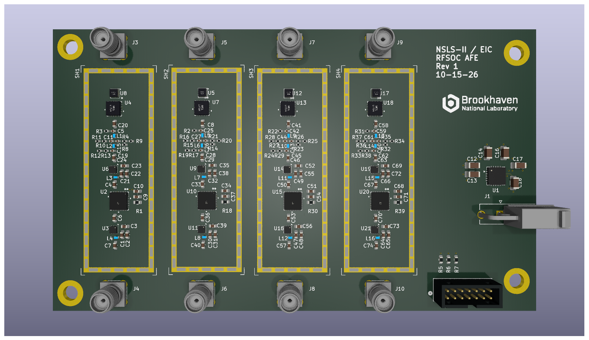

# EIC BxB RF Front End

Four-channel analog RF front-end (AFE) board for bunch-by-bunch (BxB) signal acquisition at the Electron-Ion Collider (EIC).

[](eic_afe.png)

| Item | Description |
|---|---|
| Project | EIC BxB RF Front End |
| Drawing number | To be assigned |
| Revision | To be assigned |
| README updated | October 16, 2026 |
| Design software | KiCad 9 (schematic export: 9.0.9) |
| PCB | Six layers, 1.6 mm nominal thickness **planned**; confirm in fabrication release |
| RF channels | Four independent, nominally identical channels (A, B, C, D) |
| RF connectors | Amphenol RF 132134, 50-ohm straight through-hole SMA |

## Overview

The board conditions four broadband RF inputs for subsequent bunch-by-bunch acquisition. Each channel has **one RF input and one RF output**, with a fixed input attenuator, an XLF-172H+ low-pass filter, a separate 117 MHz absorptive Gaussian low-pass filter network, two RF gain blocks, and a digitally programmable attenuator between the gain blocks.

All four RF chains use the same schematic circuit, instantiated as separate hierarchical sheets. Each channel has a dedicated input and output.

The intended application is EIC bunch-by-bunch beam diagnostics. RF bandwidth, gain, noise, dynamic range, and pulse-shape performance must be confirmed through simulation and bench measurements; they are not established by the schematic alone.

## RF signal path

Each channel follows the same topology:

```text
SMA RF input
    |
    v
RCAT-01+ fixed 1 dB attenuator
    |
    v
XLF-172H+ input low-pass filter
    |
    v
AC coupling
    |
    v
117 MHz absorptive Gaussian low-pass filter
(discrete L/C network with resistive terminations)
    |
    v
TRF37D73 first RF amplifier
    |
    v
PE43712B-Z digitally controlled step attenuator
    |
    v
TRF37D73 second RF amplifier
    |
    v
AC coupling
    |
    v
SMA RF output
```

The fixed input attenuator improves the input match and provides some isolation. The signal then passes through the **XLF-172H+ low-pass filter**. **After the XLF-172H+**, a separate **117 MHz absorptive Gaussian low-pass filter** is implemented with discrete inductors, capacitors, and resistive terminations. This network sets the intended pulse-shaping response and is designed to absorb out-of-band energy and reduce ringing. The filtered signal then enters the first TRF37D73 amplifier. Both TRF37D73 gain blocks operate from the local +3.3 V supply, with RF bias chokes and local bypass capacitors.

The PE43712B-Z is placed **between the two amplifiers**, allowing the signal level delivered to the second amplifier to be adjusted digitally. The output level depends on the two amplifier gains, fixed attenuation, programmable attenuation, and losses in the filter and passive networks.

The schematic uses AC-coupling capacitors between the XLF-172H+ and the discrete Gaussian network, at the amplifier and attenuator interfaces, and at the RF output. No separate output low-pass filter is shown after the second amplifier.

### Channel and component map

| Channel | RF input | Fixed attenuator | XLF filter | First amplifier | Digital attenuator | Second amplifier | RF output | Shield |
|---|---|---|---|---|---|---|---|---|
| A | J3 | U8 | U4 | U6 | U2 | U3 | J4 | SH1 |
| B | J5 | U5 | U7 | U9 | U10 | U11 | J6 | SH2 |
| C | J7 | U12 | U13 | U14 | U15 | U16 | J8 | SH3 |
| D | J9 | U17 | U18 | U19 | U20 | U21 | J10 | SH4 |

**Major RF parts per channel**

- **RCAT-01+** — fixed 1 dB RF attenuator.
- **XLF-172H+** — first-stage input low-pass filter, ahead of the Gaussian network.
- **117 MHz absorptive Gaussian low-pass filter** — separate discrete network after the XLF-172H+, built from 68 nH inductors, 13 pF capacitors, and 49.9-ohm resistive elements as shown in each channel schematic. Its complete response must be evaluated as a network.
- **TRF37D73** — two 3.3 V RF gain blocks, one ahead of and one after the digital attenuator.
- **PE43712B-Z** — digitally programmable RF step attenuator.

## Digital attenuator control

Digital control enters through **J2 (878311420)**. Three control signals pass through 22-ohm series resistors **R5–R7** before being distributed to all four channel sheets:

| Net | Function |
|---|---|
| `atten_si` | Serial data input (SI) |
| `atten_clk` | Serial clock (CLK) |
| `atten_le` | Latch enable (LE) |

The same `atten_si`, `atten_clk`, and `atten_le` nets connect to **all four PE43712B-Z devices**. Therefore, the present schematic provides **common/parallel programming**, not independent attenuator control for channels A–D. All four devices receive the same serial transactions and latch signal.

Each channel includes a 10-kohm pull-up on its attenuator `*P/S` pin, consistent with the intended serial-control configuration. The digital attenuator supply is +3.3 V.

## Power supply

External **+5 V DC** enters at **J1 (39301022)** and feeds **U1 (TPS7A4700xRGW)**, a low-noise linear regulator configured in the schematic for the **+3.3 V** RF supply.

The regulator circuit includes input capacitors **C16 (10 µF)** and **C17 (1 µF)**; output capacitors **C12–C14 (10 µF, 10 µF, and 47 µF)**; and **C18 (1 µF)** on the NR pin. The +3.3 V rail powers the two TRF37D73 amplifiers and the PE43712B-Z attenuator in each channel.

The amplifier bias feeds use **530 nH RF chokes** with local 100 pF, 10 nF, and 1 µF bypass capacitors. The attenuator supply has local 0.1 µF and 0.01 µF bypassing. Component placement, ground return, and regulator thermal/current margins should be checked as part of layout verification.

## Connector summary

| Reference | Function | Part / notes |
|---|---|---|
| J1 | +5 V DC input | 39301022, two-position connector |
| J2 | Shared attenuator control | 878311420, 14-position connector; three signal lines, ground returns |
| J3 / J4 | Channel A RF input / output | 132134 SMA |
| J5 / J6 | Channel B RF input / output | 132134 SMA |
| J7 / J8 | Channel C RF input / output | 132134 SMA |
| J9 / J10 | Channel D RF input / output | 132134 SMA |

Four grounded mounting holes (**MT1–MT4**) are also shown on the root schematic.

## RF shielding and PCB construction

Each RF channel includes a separate **two-piece RF shield** symbol (**SH1–SH4**) with a solderable frame and removable cover. The final shield part number, usable *interior* dimensions, solder-land pattern, lid clearance, and enclosure compatibility must be verified against the PCB layout. The selected shield must clear all RF components and must not short signal traces crossing the frame boundary.

A **six-layer, 1.6 mm** PCB is planned, but the attached document is a schematic export and does not define a released PCB stackup or layout. The following are **design targets**, not verified fabrication facts:

- Use controlled-impedance **50-ohm** RF routing, including all SMA launches and interlayer transitions.
- Provide continuous RF ground reference planes; reserve dedicated ground layers as appropriate to the final stackup.
- Keep the XLF-172H+ filter, 117 MHz discrete Gaussian filter network, amplifiers, and attenuator close together within each channel's shielded area.
- Stitch each shield frame to ground with an appropriate via pattern.
- Route signals crossing a continuous shield wall on another copper layer, with the correct reference plane and return-current paths.
- Review SMA through-hole pin geometry, excess lead/stub length, and antipad/ground-via placement for the required RF bandwidth.
- Confirm whether any via-in-pad structures require filling/capping in the fabrication notes; the schematic alone does not establish this requirement.

## Design and verification notes

- The four RF chains are nominally identical and each has **one input and one output**.
- The programmable attenuators share a **single serial-control bus**; they are not independently adjustable in this schematic.
- The digital attenuation is applied **between** two RF amplifier stages.
- The **XLF-172H+** is an input low-pass filter; a **separate 117 MHz absorptive Gaussian low-pass filter network follows it**, ahead of the first amplifier. No post-amplifier output low-pass filter is shown.
- Verify overall frequency response, time-domain pulse response, gain, noise, compression, and dynamic range for the intended beam-signal amplitude and bunch spacing.
- Check power-up settings and permissible control-voltage levels of the PE43712B-Z before operating the board.
- Maintain the specified RF geometry at SMA launch pads, device pads, shield crossings, and layer transitions.
- Any change to PCB stackup or RF line geometry requires impedance re-evaluation.
- Cross-check the schematic, PCB, bill of materials, and fabrication outputs before releasing the design.

## Repository contents

The KiCad schematic hierarchy consists of:

- `eic_afe.kicad_sch` — root schematic with four RF channels, connectors, controls, and mounting holes.
- `rf_chain.kicad_sch` — common RF-chain schematic, instantiated as Channels A, B, C, and D.
- `regulator.kicad_sch` — +5 V input and +3.3 V linear regulator.

A release may also include the `.kicad_pro` project file, PCB layout, custom libraries, 3D models, BOM, manufacturing outputs, and exported schematic PDF (`eic_afe_sch.pdf`).

## Organization

Brookhaven National Laboratory (BNL)  
Electron-Ion Collider (EIC)
